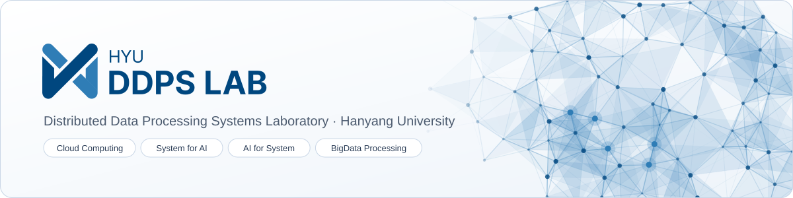

<picture>
  <source media="(prefers-color-scheme: dark)" srcset="./banner-dark.svg">
  
</picture>

  

  

We are the **Distributed Data Processing Systems Laboratory (DDPS Lab)** at **Hanyang University**.
We build high-performance, cost-effective, and easy-to-use computer systems, from edge devices to cloud-scale clusters.

## Research Areas

| Area | Focus |
|------|-------|
| ☁️ **Cloud Computing** | Spot instance datasets and resource optimization, spot instances for LLM training and serving, cloud performance modeling and cost optimization |
| 🧠 **System for AI** | LLM serving on heterogeneous GPUs, WebAssembly runtimes for AI workloads, edge-cloud continuum, AI agent infrastructure |
| 🛠️ **AI for System** | Root cause analysis for cloud systems, AI agents for system operations, AIOps |
| 📊 **BigData Processing** | Time-series processing, serverless data pipelines, large-scale matrix operations |

## Featured Projects

| Project | Description | Paper |
|---------|-------------|-------|
| [**SpotLake**](https://github.com/ddps-lab/spotlake) | Public spot instance dataset archive across AWS, Azure, and GCP | IISWC '22, WWW '23 Demo |
| [**KubePACS**](https://github.com/ddps-lab/KubePACS) | Kubernetes cluster on performant, highly available, cost-efficient spot instances | Middleware '26 |
| [**ShuntServe**](https://github.com/ddps-lab/ShuntServe) | Cost-efficient LLM serving on heterogeneous spot GPU clusters | FGCS |
| [**SpotVista**](https://github.com/ddps-lab/SpotVista) | Availability-aware multi-node spot instance recommendation | |
| [**LiveMigrate-Detector**](https://github.com/ddps-lab/LiveMigrate-Detector) | Workload-aware live-migratable cloud instance detector | CCGrid '24, TCC |
| [**PROFET**](https://github.com/ddps-lab/profet) | Profiling-based CNN training latency prediction for GPU cloud instances | IEEE BigData '22 |
| [**FunctionBench**](https://github.com/ddps-lab/serverless-faas-workbench) | Workload suite for serverless cloud function services | IEEE CLOUD '19 |
| [**DoS**](https://github.com/ddps-lab/dos) | Dense or Sparse: elastic SpMM for big-data processing | IEEE TBD |

See all projects at [ddps.cloud/project](https://ddps.cloud/project).

## Contact

📮 [ddpslab@hanyang.ac.kr](mailto:ddpslab@hanyang.ac.kr) · ☎️ +82-2-2220-2656 
🏫 Department of Data Science · Department of Artificial Intelligence, Hanyang University, Seoul

Prospective students and collaborators are welcome to reach out by email.

DDPS Lab · Hanyang University · <a href="https://ddps.cloud">ddps.cloud</a>

